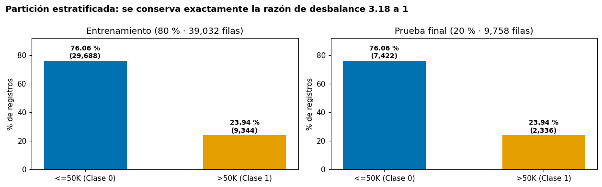
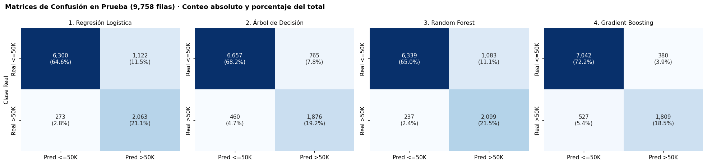
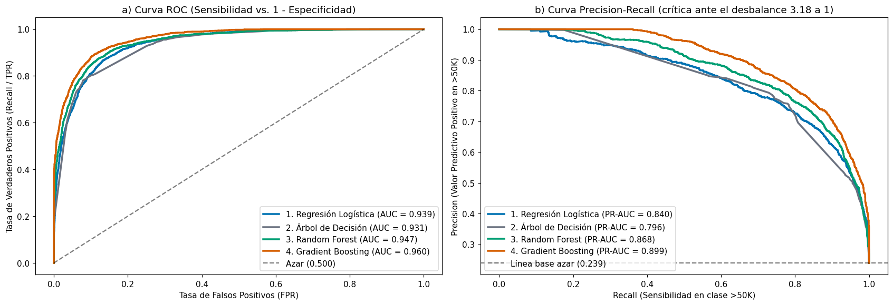
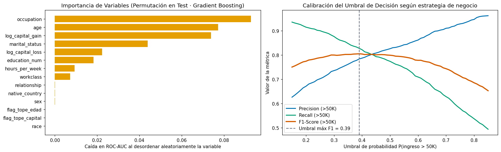

---
jupyter:
  colab:
  kernelspec:
    display_name: Python 3
    language: python
    name: python3
  language_info:
    codemirror_mode:
      name: ipython
      version: 3
    file_extension: .py
    mimetype: text/x-python
    name: python
    nbconvert_exporter: python
    pygments_lexer: ipython3
    version: 3.10.12
  nbformat: 4
  nbformat_minor: 5
---

# Aplicación de Machine Learning con Python · Adult Income

### ¿Podemos predecir con precisión y equidad quién supera los USD 50,000 al año? Del análisis exploratorio a la decisión con modelos supervisados

**Proyecto ACA 2 · Programación para Analítica de Datos e Inteligencia Artificial**

Especialización en Inteligencia Artificial

Docente: Carlos Mario Minu Quiroga

------------------------------------------------------------------------

| Integrante | Profesión | Ciudad | Lente analítico que aporta al proyecto (ACA 2) |
|----|----|----|----|
| Luisa Fernanda Vega Pulecio | Diseñadora de multimedia | Bogotá | Narrativa visual de métricas (ROC, PR, matrices de confusión), accesibilidad (*Okabe-Ito*) y lectura ejecutiva |
| Camilo Andrey Rojas García | Ingeniero de sistemas | Mocoa | Arquitectura de `Pipeline` y `ColumnTransformer`, prevención de fuga de información (*data leakage*) y validación cruzada |
| Diego Fernando López León | Ingeniero de sistemas | Bogotá | Calidad de datos, reproducibilidad del entrenamiento, código claro y validaciones automáticas con `assert` |
| Johan Sebastian Díaz Jiménez | Ingeniero de telecomunicaciones | Bogotá | Señal vs. ruido (`fnlwgt`), compresión logarítmica de colas extremas y calibración del umbral de decisión |
| Jhonathan Correa Valencia | Administrador de empresas | Pereira | Traducción de falsos positivos/negativos a costos de negocio, selección estratégica del modelo y equidad |

> **Convención numérica:** el notebook conserva punto decimal y coma como separador de miles (igual que las salidas de Python y que el ACA 1), por ejemplo `48,790` filas y `23.94 %`.

## Resumen ejecutivo

Retomamos los **48,790 registros limpios** del censo de EE. UU. de 1994 (*Adult Income*) auditados en el ACA 1 para resolver un problema de **clasificación binaria supervisada**: predecir si el ingreso anual de una persona adulta supera los USD 50,000 (`ingreso_alto = 1`, **23.94 %** de la muestra) o no (`ingreso_alto = 0`, **76.06 %**).

1.  **Continuidad con el EDA y preprocesamiento sin *data leakage*:** descartamos `fnlwgt` (peso muestral sin correlación con el ingreso) y `education` (100 % redundante con `education_num`), conservamos la categoría explícita `"No reporta"` para los faltantes informativos de ocupación/empleador, comprimimos la asimetría extrema del capital con `log(1 + x)` y marcamos los códigos truncados (`99,999` y `90` años). El escalamiento (`StandardScaler`) y la codificación (`OneHotEncoder`) se encapsularon en un `ColumnTransformer` ajustado **exclusivamente sobre el conjunto de entrenamiento** (80 % = 39,032 filas) y evaluado sobre prueba estratificada (20 % = 9,758 filas).
2.  **Entrenamiento y comparación de cuatro familias de modelos:** mediante validación cruzada estratificada de 5 pliegues (`StratifiedKFold`) entrenamos y comparamos **Regresión Logística** (`class_weight='balanced'`), **Árbol de Decisión** (`class_weight='balanced'`), **Random Forest** (`class_weight='balanced_subsample'`) y **Gradient Boosting (`HistGradientBoostingClassifier`)**.
3.  **Selección del modelo ganador sustentada en evidencia:** **Gradient Boosting** obtiene el mejor desempeño integral en prueba (**ROC-AUC = 0.960**, **PR-AUC = 0.899**, **F1-Score = 0.800** y **Accuracy = 90.7 %**), superando a los modelos lineales y a los árboles individuales al capturar automáticamente interacciones no lineales (edad × horas y educación × ocupación).
4.  **Interpretación crítica y decisión de negocio:** la importancia por permutación confirma que `marital_status`, `education_num`, `log_capital_gain`, `age` y `occupation` concentran la señal predictiva. Además, demostramos cómo calibrar el umbral de probabilidad según el costo de los **falsos positivos** (riesgo crediticio o gasto comercial mal asignado) frente a los **falsos negativos** (costo de oportunidad al perder clientes de alto valor).

## Contenido

1.  Definición del problema, contexto del dataset y justificación del tipo de tarea
2.  Configuración del entorno
3.  Obtención del dataset desde GitHub y limpieza trazable con el ACA 1
4.  Separación de variables predictoras (*features*), variable objetivo (*target*) y selección de variables
5.  Partición de datos, análisis del desbalance de clases y `Pipeline` libre de *data leakage*
6.  Entrenamiento y validación cruzada de cuatro modelos de Machine Learning
7.  Evaluación en el conjunto de prueba y visualización de resultados (Matrices de confusión, curvas ROC y PR)
8.  Comparación argumentada entre modelos y selección del modelo final
9.  Interpretabilidad: importancia de variables, discusión de errores (FP vs. FN) y aplicaciones por perfil profesional
10. Limitaciones, ética algorítmica, reproducibilidad y conclusiones

------------------------------------------------------------------------

# 1. Definición del problema, contexto del dataset y justificación del tipo de tarea

## 1.1 Contexto y conexión con el ACA 1

El dataset **Adult** (*Census Income*, publicado en el *UCI Machine Learning Repository* por Becker & Kohavi, 1996) reúne información demográfica, educativa, patrimonial y laboral de personas adultas del censo de EE. UU. de 1994. En el **ACA 1** demostramos de forma exploratoria que ganar más de **USD 50,000 al año** no depende de un único atributo aislado, sino de la combinación entre estructura del hogar (`marital_status`), escalones educativos (`education_num`), etapa del ciclo de vida (`age`), intensidad horaria (`hours_per_week`), oficio (`occupation`) y rentas de capital (`capital_gain`).

Sin embargo, una regla descriptiva simple (como segmentar solo a «casados/as con pregrado o más») alcanza una precisión alta pero deja por fuera al **59 % de las personas que también superan los USD 50,000** (como dueños de empresas incorporadas sin título universitario o jóvenes profesionales solteros con ganancias de capital). Para superar esa limitación, pasamos del análisis descriptivo al **modelado predictivo con Machine Learning supervisado**.

## 1.2 Variable objetivo (*target*) y justificación del enfoque: ¿Clasificación o Regresión?

- **Variable objetivo original:** `income`, registrada en el censo con dos categorías mutuamente excluyentes: `"<=50K"` y `">50K"`.
- **Variable objetivo codificada (`y`):** `ingreso_alto`, donde `1` identifica al grupo de ingresos altos (`>50K`, **23.94 %** del dataset limpio) y `0` identifica al grupo de ingresos medios/bajos (`<=50K`, **76.06 %**).
- **Justificación sólida del tipo de problema:** el problema corresponde estrictamente a **Clasificación Binaria Supervisada** y no a regresión porque la variable dependiente no es un monto salarial continuo en dólares, sino una **clase discreta dicotómica** definida por el umbral censal de USD 50,000. Es **supervisado** porque cada registro histórico cuenta con su etiqueta real verificada para entrenar los algoritmos y medir objetivamente sus aciertos y errores.

| Ámbito profesional | ¿Para qué sirve este clasificador en la práctica? |
|----|----|
| **Banca privada y servicios financieros** | Priorizar prospectos con alta probabilidad de superar el umbral de ingresos para ofrecer productos de inversión, seguros o tarjetas patrimoniales. |
| **Riesgo de crédito** | Complementar la validación de capacidad de pago estimando la probabilidad de pertenecer al segmento de altos ingresos cuando los soportes son parciales. |
| **Políticas de empleo y formación** | Simular cómo cambia la probabilidad de superar el umbral de ingresos al completar niveles educativos o transitar hacia ocupaciones técnicas/directivas. |
| **Auditoría de talento y equidad** | Detectar si las decisiones automatizadas penalizan desproporcionadamente a subgrupos demográficos mediante el análisis de falsos negativos por clase. |

------------------------------------------------------------------------

# 2. Configuración del entorno

> **Lente · Diseño multimedia (Luisa).** Mantenemos la paleta *Okabe-Ito* del ACA 1 (apta para daltonismo) y una jerarquía visual limpia: azul (`#0072B2`) para la clase `<=50K` o métricas de precisión, naranja/rojo (`#E69F00` / `#D55E00`) para destacar la clase `>50K` y el modelo ganador, y verde (`#009E73`) para sensibilidad (*Recall*).

``` python
# --- Librerías de datos y visualización
import pandas as pd
import numpy as np
import matplotlib.pyplot as plt
import seaborn as sns
import sklearn
import warnings
warnings.filterwarnings("ignore")

# --- Librerías de Machine Learning (scikit-learn)
from sklearn.model_selection import train_test_split, StratifiedKFold, cross_validate
from sklearn.preprocessing import StandardScaler, OneHotEncoder
from sklearn.compose import ColumnTransformer
from sklearn.pipeline import Pipeline
from sklearn.linear_model import LogisticRegression
from sklearn.tree import DecisionTreeClassifier
from sklearn.ensemble import RandomForestClassifier, HistGradientBoostingClassifier
from sklearn.inspection import permutation_importance
from sklearn.metrics import (
    accuracy_score, precision_score, recall_score, f1_score,
    roc_auc_score, average_precision_score, confusion_matrix,
    classification_report, roc_curve, precision_recall_curve
)

# --- Estilo general de los gráficos y paleta Okabe-Ito
sns.set_theme(style="whitegrid")
plt.rcParams["figure.dpi"] = 110
plt.rcParams["axes.titleweight"] = "bold"
plt.rcParams["axes.titlelocation"] = "left"

AZUL, NARANJA, GRIS = "#0072B2", "#E69F00", "#6B7280"
ROSA, VERDE, ROJO = "#CC79A7", "#009E73", "#D55E00"

SEMILLA = 42
np.random.seed(SEMILLA)

pd.set_option("display.max_columns", 40)
pd.set_option("display.float_format", "{:,.3f}".format)

print(f"pandas {pd.__version__} | numpy {np.__version__} | scikit-learn {sklearn.__version__} | seaborn {sns.__version__}")
print(f"Semilla de reproducibilidad fijada en: {SEMILLA}")
```

    pandas 2.0.0 | numpy 1.26.3 | scikit-learn 1.4.0 | seaborn 0.12.2
    Semilla de reproducibilidad fijada en: 42

------------------------------------------------------------------------

# 3. Obtención del dataset desde GitHub y limpieza trazable con el ACA 1

Conservamos exactamente la misma fuente de datos del ACA 1 (descarga directa del archivo `adult-all.csv` desde el repositorio de GitHub `jbrownlee/Datasets`) y replicamos en un bloque limpio y auditable todas las decisiones de calidad de datos demostradas en la primera entrega:

1.  **Faltantes codificados como `"?"`:** en el ACA 1 probamos con una prueba $\chi^2$ ($p \approx 1.3 \times 10^{-76}$) que la ausencia de `occupation` y `workclass` **no es aleatoria sino informativa** (quienes no reportan ocupación tienen solo 9.4 % de ingresos altos frente a 24.8 % de quienes sí la reportan). Por tanto, imputar con la moda sesgaría el modelo; los transformamos en la categoría explícita **`"No reporta"`**.
2.  **Duplicados exactos:** eliminamos las **52 filas idénticas** en las 15 columnas (0.11 % del total), pasando de `48,842` a `48,790` registros únicos.
3.  **Transformación de colas extremas y códigos truncados (*top-coding*):** dado que el 91.7 % de `capital_gain` y el 95.3 % de `capital_loss` son ceros pero existen valores extremos de hasta `99,999` (donde el 100 % gana `>50K`), creamos `log_capital_gain = log(1 + capital_gain)`, `log_capital_loss = log(1 + capital_loss)` y las banderas indicadoras `flag_tope_capital` (`capital_gain == 99999`) y `flag_tope_edad` (`age == 90`).

> **Lente · Ingeniería de sistemas (Camilo y Diego).** Mantenemos el conjunto original intacto en `df_raw`, ejecutamos las transformaciones sobre `df_clean` y cerramos con validaciones automáticas (`assert`) que garantizan que el punto de partida del ACA 2 sea idéntico al cierre del ACA 1.

``` python
# Nombres de las 15 columnas según la documentación oficial de UCI (adult.names)
columnas = [
    "age", "workclass", "fnlwgt", "education", "education_num", "marital_status",
    "occupation", "relationship", "race", "sex", "capital_gain", "capital_loss",
    "hours_per_week", "native_country", "income"
]

# Descarga directa desde GitHub (misma ruta utilizada en el ACA 1)
url = "https://raw.githubusercontent.com/jbrownlee/Datasets/master/adult-all.csv"
df_raw = pd.read_csv(url, header=None, names=columnas, skipinitialspace=True)

# 1. Conversión de "?" en NaN y eliminación de los 52 duplicados exactos
df_clean = df_raw.replace("?", np.nan).drop_duplicates().reset_index(drop=True)

# 2. Tratamiento de faltantes informativos como categoría explícita "No reporta"
for col in ["workclass", "occupation", "native_country"]:
    df_clean[col] = df_clean[col].fillna("No reporta")

# 3. Transformación logarítmica de capital e indicadores de truncamiento (top-coding)
df_clean["log_capital_gain"] = np.log1p(df_clean["capital_gain"])
df_clean["log_capital_loss"] = np.log1p(df_clean["capital_loss"])
df_clean["flag_tope_capital"] = (df_clean["capital_gain"] == 99999).astype(int)
df_clean["flag_tope_edad"] = (df_clean["age"] == 90).astype(int)

# 4. Variable objetivo binaria: 1 = >50K, 0 = <=50K
df_clean["ingreso_alto"] = (df_clean["income"] == ">50K").astype(int)

# 5. Validaciones automáticas (assert)
assert len(df_clean) == 48790, "El número de registros limpios debe coincidir con los 48,790 del ACA 1"
assert df_clean.isna().sum().sum() == 0, "No deben quedar valores nulos"
assert set(df_clean["ingreso_alto"].unique()) == {0, 1}, "El objetivo debe ser binario {0, 1}"

print(f"Dimensiones originales (df_raw) : {df_raw.shape[0]:,} filas × {df_raw.shape[1]} columnas")
print(f"Dimensiones limpias (df_clean)  : {df_clean.shape[0]:,} filas × {df_clean.shape[1]} columnas (52 duplicados eliminados)")
print("Validaciones automáticas (assert): SUPERADAS CON ÉXITO")
print(f"Prevalencia de ingresos >50K    : {df_clean['ingreso_alto'].mean():.2%} ({df_clean['ingreso_alto'].sum():,} personas)")
df_clean.head(5)
```

    Dimensiones originales (df_raw) : 48,842 filas × 15 columnas
    Dimensiones limpias (df_clean)  : 48,790 filas × 20 columnas (52 duplicados eliminados)
    Validaciones automáticas (assert): SUPERADAS CON ÉXITO
    Prevalencia de ingresos >50K    : 23.94% (11,680 personas)

| # | age | workclass | fnlwgt | education | education_num | marital_status | occupation | relationship | race | sex | capital_gain | capital_loss | hours_per_week | native_country | income | log_capital_gain | log_capital_loss | flag_tope_capital | flag_tope_edad | ingreso_alto |
|---|---|---|---|---|---|---|---|---|---|---|---|---|---|---|---|---|---|---|---|---|
| 0 | 40 | Federal-gov | 333351 | HS-grad | 9 | Never-married | Adm-clerical | Unmarried | White | Female | 0 | 0 | 40 | United-States | <=50K | 0.000 | 0.000 | 0 | 0 | 0 |
| 1 | 64 | Local-gov | 130982 | Doctorate | 16 | Never-married | Adm-clerical | Own-child | White | Male | 0 | 0 | 41 | United-States | >50K | 0.000 | 0.000 | 0 | 0 | 1 |
| 2 | 29 | Private | 274154 | Some-college | 10 | Married-civ-spouse | Sales | Wife | White | Female | 3103 | 0 | 40 | United-States | <=50K | 8.040 | 0.000 | 0 | 0 | 0 |
| 3 | 18 | Private | 308222 | HS-grad | 9 | Married-civ-spouse | Adm-clerical | Husband | White | Male | 0 | 0 | 40 | Canada | <=50K | 0.000 | 0.000 | 0 | 0 | 0 |
| 4 | 55 | Local-gov | 86037 | Some-college | 10 | Never-married | Exec-managerial | Not-in-family | White | Male | 0 | 2415 | 41 | United-States | >50K | 0.000 | 7.790 | 0 | 0 | 1 |

------------------------------------------------------------------------

# 4. Separación de variables predictoras (*features*), variable objetivo (*target*) y selección de variables

Un error frecuente al pasar del EDA al modelado es incluir todas las columnas disponibles sin evaluar su pertinencia, redundancia o riesgo de fuga de datos. En la siguiente tabla justificamos cada decisión de selección de variables para la matriz predictora `X` y el vector objetivo `y`:

| Columna | Rol asignado | Tratamiento y justificación técnica |
|----|----|----|
| `ingreso_alto` | **Variable objetivo (`y`)** | Entero binario (`1` si `>50K`, `0` si `<=50K`). |
| `income` | **Descartada** | Es la representación en texto de la variable objetivo; incluirla en `X` produciría fuga directa de la respuesta. |
| `fnlwgt` | **Descartada (No pertinente)** | Representa el peso muestral asignado por la Oficina del Censo según el estado y perfil demográfico, no una característica productiva del individuo. En el ACA 1 comprobamos que su correlación con el ingreso es nula ($r_s = -0.01$). En árboles de decisión, una variable continua ruidosa con 28,523 valores distintos genera particiones espurias y *overfitting*. |
| `education` | **Descartada (Redundante)** | En la sección 5.3 del ACA 1 verificamos que existe una correspondencia exacta 1 a 1 entre las 16 etiquetas de `education` y los enteros de `education_num` (1 = preescolar ... 16 = doctorado). Conservar `education_num` preserva el orden natural de la escolaridad y ahorra 16 columnas *dummy* colineales. |
| `capital_gain`, `capital_loss` | **Reemplazadas por `log_capital_gain`, `log_capital_loss` y `flag_tope_capital`** | Sustituimos los montos crudos por su transformación `log(1 + x)` y el indicador de truncamiento en `99,999`. Esto evita que los gradientes de la Regresión Logística exploten ante valores de cinco dígitos, al tiempo que conserva el orden monótono exacto para los algoritmos basados en árboles. |
| `age`, `education_num`, `hours_per_week`, `flag_tope_edad` | **Predictoras numéricas (7 en total junto con capital)** | Variables cuantitativas y banderas de saturación que se estandarizarán con `StandardScaler`. |
| `workclass`, `marital_status`, `occupation`, `relationship`, `race`, `sex`, `native_country` | **Predictoras categóricas (7 en total)** | Variables nominales que se codificarán mediante `OneHotEncoder(handle_unknown='ignore')`. |

> **Lente · Ingeniería de telecomunicaciones (Johan).** Eliminar `fnlwgt` y `education` aumenta la relación señal/ruido (*SNR*) del vector de entrada, mientras que `log1p` actúa como un compresor logarítmico (ley $\mu$) que permite que tanto un clasificador lineal como un árbol procesen ganancias de capital desde USD 0 hasta USD 99,999 sin saturarse.

------------------------------------------------------------------------

# 5. Partición de datos, análisis del desbalance y `Pipeline` libre de *data leakage*

## 5.1 Estrategia de validación y prevención de fugas de información (*data leakage*)

Para evaluar con rigor la capacidad de generalización de los modelos implementamos un esquema mixto de **separación Entrenamiento / Prueba estratificada (80 % / 20 %) combinada con Validación Cruzada Estratificada de 5 pliegues (`StratifiedKFold`, $k=5$) dentro del entrenamiento**:

- **Conjunto de Entrenamiento (`X_train`, `y_train` --- 80 %, 39,032 registros):** se divide internamente en 5 pliegues estratificados durante la validación cruzada para comparar los modelos con media y desviación estándar, y luego ajusta los parámetros finales.
- **Conjunto de Prueba (`X_test`, `y_test` --- 20 %, 9,758 registros):** permanece completamente aislado hasta la sección 7. Funciona como un examen final sobre datos nunca vistos.
- **Cero *data leakage*:** el `StandardScaler` (que calcula media y desviación estándar de las variables numéricas) y el `OneHotEncoder` (que aprende el catálogo de categorías) están dentro de un `ColumnTransformer` acoplado a un `Pipeline` de `scikit-learn`. Así, en cada pliegue de validación cruzada y en la evaluación final, las estadísticas de transformación se aprenden **exclusivamente con las filas de entrenamiento** y solo se aplican (`.transform()`) a validación o prueba.

## 5.2 Análisis del desbalance de clases y justificación del tratamiento

La variable objetivo presenta una distribución de **76.06 % para la clase `0` (`<=50K`) y 23.94 % para la clase `1` (`>50K`)**, lo que equivale a una **razón de desbalance de 3.18 a 1**.

- **Impacto del desbalance:** un clasificador ingenuo que predijera siempre `"<=50K"` obtendría un engañoso **76.06 % de *Accuracy***, pero tendría **0 % de *Recall*** en la clase de ingresos altos (sería inútil para el negocio).
- **Justificación de la estrategia elegida:** utilizamos **ponderación inversamente proporcional a la frecuencia de clase (`class_weight='balanced'`)** en Regresión Logística, Árbol de Decisión y Random Forest (`balanced_subsample`), penalizando 3.18 veces más los errores cometidos sobre personas de ingresos altos, y comparamos este enfoque frente a la calibración probabilística nativa de **Gradient Boosting**, complementada en la sección 9 con la **optimización explícita del umbral de decisión**.

``` python
# 1. Definición explícita de variables predictoras (features) y variable objetivo (target)
features_numericas = [
    "age", "education_num", "hours_per_week",
    "log_capital_gain", "log_capital_loss",
    "flag_tope_capital", "flag_tope_edad"
]

features_categoricas = [
    "workclass", "marital_status", "occupation",
    "relationship", "race", "sex", "native_country"
]

X = df_clean[features_numericas + features_categoricas].copy()
y = df_clean["ingreso_alto"].copy()

# 2. Partición estratificada 80 % entrenamiento y 20 % prueba
X_train, X_test, y_train, y_test = train_test_split(
    X, y, test_size=0.20, random_state=SEMILLA, stratify=y
)

# 3. Gráfico de verificación de la distribución de clases en ambos subconjuntos
fig, axes = plt.subplots(1, 2, figsize=(11.5, 3.6))
for ax, serie, titulo in zip(axes, [y_train, y_test],
                             ["Entrenamiento (80 % · 39,032 filas)", "Prueba final (20 % · 9,758 filas)"]):
    props = serie.value_counts(normalize=True).sort_index() * 100
    conteos = serie.value_counts().sort_index()
    barras = ax.bar(["<=50K (Clase 0)", ">50K (Clase 1)"], props.values, color=[AZUL, NARANJA], width=0.52)
    for b, c, p in zip(barras, conteos.values, props.values):
        ax.text(b.get_x() + b.get_width()/2, p + 2, f"{p:.2f} %\n({c:,})", ha="center", fontweight="bold", fontsize=9)
    ax.set_ylim(0, 92)
    ax.set_ylabel("% de registros")
    ax.set_title(titulo)
plt.suptitle("Partición estratificada: se conserva exactamente la razón de desbalance 3.18 a 1",
             x=0.01, ha="left", fontweight="bold")
plt.tight_layout()
plt.show()

# 4. Construcción del preprocesador (se ajustará únicamente con X_train dentro de cada Pipeline)
preprocesador = ColumnTransformer(
    transformers=[
        ("num", StandardScaler(), features_numericas),
        ("cat", OneHotEncoder(handle_unknown="ignore", sparse_output=False), features_categoricas)
    ],
    remainder="drop"
)

X_train_prep_shape = preprocesador.fit_transform(X_train).shape
print(f"Variables predictoras seleccionadas: {len(features_numericas)} numéricas + {len(features_categoricas)} categóricas = {X.shape[1]} columnas")
print("Variables descartadas (evidencia ACA 1): 'fnlwgt' (ruido muestral), 'education' (redundante con education_num), 'income' (target)")
print(f"Entrenamiento (X_train): {X_train.shape[0]:,} filas | Tasa >50K = {y_train.mean():.2%}")
print(f"Prueba final  (X_test) : {X_test.shape[0]:,} filas | Tasa >50K = {y_test.mean():.2%}")
print(f"Columnas tras OneHotEncoder (ajustado solo en X_train): {X_train_prep_shape[1]} features numéricas listas para modelado")
```

    Variables predictoras seleccionadas: 7 numéricas + 7 categóricas = 14 columnas
    Variables descartadas (evidencia ACA 1): 'fnlwgt' (ruido muestral), 'education' (redundante con education_num), 'income' (target)
    Entrenamiento (X_train): 39,032 filas | Tasa >50K = 23.94%
    Prueba final  (X_test) : 9,758 filas | Tasa >50K = 23.94%
    Columnas tras OneHotEncoder (ajustado solo en X_train): 55 features numéricas listas para modelado



------------------------------------------------------------------------

# 6. Entrenamiento y comparación de cuatro modelos de Machine Learning

Para cubrir distintas hipótesis inductivas y niveles de complejidad algorítmica, entrenamos y validamos **cuatro modelos supervisados** (superando el mínimo de tres exigido):

1.  **Modelo 1 · Regresión Logística (`LogisticRegression`):** clasificador lineal paramétrico que modela el logaritmo de las *odds* de superar los USD 50,000 como una combinación lineal de los predictores estandarizados. Requiere obligatoriamente el `StandardScaler` para que la regularización $L_2$ actúe de forma equitativa sobre todas las variables.
2.  **Modelo 2 · Árbol de Decisión (`DecisionTreeClassifier`):** modelo no paramétrico que divide recursivamente el espacio de variables mediante cortes ortogonales que minimizan la impureza de Gini. Se parametriza con `max_depth=8` y `min_samples_leaf=50` para obtener reglas generalizables y evitar que memorice hojas con pocos individuos.
3.  **Modelo 3 · Random Forest (`RandomForestClassifier`):** ensamble paralelo (*Bagging*) compuesto por 150 árboles de decisión entrenados sobre muestras *bootstrap* e inyección aleatoria de subconjuntos de variables en cada nodo (`max_depth=14`, `min_samples_leaf=20`). Reduce drásticamente la varianza e inestabilidad del árbol individual.
4.  **Modelo 4 · Gradient Boosting (`HistGradientBoostingClassifier`):** ensamble secuencial (*Boosting*) basado en histogramas, donde cada nuevo árbol se entrena para corregir los errores residuales (gradiente de la pérdida logarítmica) de los árboles previos (`max_iter=200`, `learning_rate=0.08`, `max_leaf_nodes=31`). Es el algoritmo de referencia en ciencia de datos aplicada para datos tabulares con interacciones complejas.

``` python
# Definición de los 4 modelos a entrenar y comparar
modelos_base = {
    "1. Regresión Logística": LogisticRegression(
        max_iter=500, class_weight="balanced", random_state=SEMILLA
    ),
    "2. Árbol de Decisión": DecisionTreeClassifier(
        max_depth=8, min_samples_leaf=50, class_weight="balanced", random_state=SEMILLA
    ),
    "3. Random Forest": RandomForestClassifier(
        n_estimators=150, max_depth=14, min_samples_leaf=20,
        class_weight="balanced_subsample", n_jobs=-1, random_state=SEMILLA
    ),
    "4. Gradient Boosting": HistGradientBoostingClassifier(
        max_iter=200, learning_rate=0.08, max_leaf_nodes=31,
        min_samples_leaf=30, random_state=SEMILLA
    )
}

# Esquema de Validación Cruzada Estratificada de 5 pliegues sobre X_train
cv = StratifiedKFold(n_splits=5, shuffle=True, random_state=SEMILLA)
metricas_cv = ["accuracy", "precision", "recall", "f1", "roc_auc", "average_precision"]

pipelines_entrenados = {}
resultados_cv = []

for nombre, algoritmo in modelos_base.items():
    pipe = Pipeline(steps=[("prep", preprocesador), ("modelo", algoritmo)])
    
    # Evaluación en 5 pliegues (sin tocar X_test)
    scores = cross_validate(pipe, X_train, y_train, cv=cv, scoring=metricas_cv, n_jobs=-1)
    
    resultados_cv.append({
        "Modelo": nombre,
        "Accuracy (CV)": f"{scores['test_accuracy'].mean()*100:.2f} ± {scores['test_accuracy'].std()*100:.2f}%",
        "Precision >50K (CV)": scores["test_precision"].mean(),
        "Recall >50K (CV)": scores["test_recall"].mean(),
        "F1-Score (CV)": scores["test_f1"].mean(),
        "ROC-AUC (CV)": scores["test_roc_auc"].mean(),
        "PR-AUC (CV)": scores["test_average_precision"].mean()
    })
    
    # Entrenamiento final del pipeline sobre el 100 % de X_train
    pipe.fit(X_train, y_train)
    pipelines_entrenados[nombre] = pipe

df_cv = pd.DataFrame(resultados_cv).set_index("Modelo")
print("Resultados en Validación Cruzada Estratificada (5 pliegues sobre X_train = 39,032 filas):")
display(df_cv)
```

    Resultados en Validación Cruzada Estratificada (5 pliegues sobre X_train = 39,032 filas):

| Modelo | Accuracy (CV) | Precision >50K (CV) | Recall >50K (CV) | F1-Score (CV) | ROC-AUC (CV) | PR-AUC (CV) |
|---|---|---|---|---|---|---|
| 1. Regresión Logística | 85.51 ± 0.47% | 0.647 | 0.871 | 0.742 | 0.939 | 0.839 |
| 2. Árbol de Decisión | 85.86 ± 2.21% | 0.675 | 0.816 | 0.736 | 0.930 | 0.799 |
| 3. Random Forest | 86.22 ± 0.52% | 0.657 | 0.889 | 0.755 | 0.946 | 0.866 |
| 4. Gradient Boosting | 90.57 ± 0.32% | 0.828 | 0.765 | 0.795 | 0.959 | 0.897 |

**Lectura de la validación cruzada.**

- La desviación estándar entre los 5 pliegues es muy baja en los modelos de ensamble ($\pm 0.32	ext{ \%}$ en Gradient Boosting y $\pm 0.52	ext{ \%}$ en Random Forest), frente a $\pm 2.21	ext{ \%}$ en el Árbol de Decisión individual. Esto demuestra empíricamente cómo el *Bagging* y el *Boosting* estabilizan la varianza de los árboles.
- Los tres modelos entrenados con `class_weight='balanced'` priorizan agresivamente el **Recall** ($0.816$ a $0.889$), mientras que **Gradient Boosting** logra el mejor equilibrio armónico (**F1-Score = 0.795**), la mayor precisión (**0.828**) y el mayor poder de ordenamiento probabilístico (**ROC-AUC = 0.959** y **PR-AUC = 0.897**).

------------------------------------------------------------------------

# 7. Evaluación en el conjunto de prueba y visualización de resultados

## 7.1 ¿Qué significa cada métrica en el contexto del problema *Adult Income*?

No basta con reportar números; cada métrica responde una pregunta distinta del negocio:

- **Accuracy (Exactitud global):** proporción total de personas bien clasificadas (tanto `<=50K` como `>50K`). Por el desbalance 3.18 a 1, nunca debe leerse sola.
- **Precision en `>50K` (Valor Predictivo Positivo):** de todas las personas que el modelo etiqueta como de ingresos altos, ¿qué porcentaje **realmente** gana más de USD 50,000? Es la métrica crítica cuando cada contacto comercial o beneficio aprobado cuesta dinero (evitar *Falsos Positivos*).
- **Recall en `>50K` (Sensibilidad / Tasa de Verdaderos Positivos):** de todas las personas que realmente ganan más de USD 50,000 en el censo, ¿qué porcentaje logra **detectar** el modelo? Es la métrica crítica cuando no queremos dejar escapar prospectos valiosos (evitar *Falsos Negativos*).
- **F1-Score en `>50K`:** media armónica entre *Precision* y *Recall*. Penaliza los extremos y resume en un solo indicador el desempeño sobre la clase minoritaria.
- **ROC-AUC y PR-AUC:** evalúan la calidad de las probabilidades entregadas por el modelo en todos los umbrales posibles. Ante clases desbalanceadas, **PR-AUC (*Precision-Recall AUC*)** es especialmente exigente porque se enfoca en la clase minoritaria `>50K` sin inflarse por el gran volumen de verdaderos negativos.

``` python
# Evaluación de los 4 pipelines sobre el conjunto de prueba aislado (X_test = 9,758 registros)
resultados_test = []
predicciones_test = {}
probabilidades_test = {}

for nombre, pipe in pipelines_entrenados.items():
    y_pred = pipe.predict(X_test)
    y_prob = pipe.predict_proba(X_test)[:, 1]
    
    predicciones_test[nombre] = y_pred
    probabilidades_test[nombre] = y_prob
    
    tn, fp, fn, tp = confusion_matrix(y_test, y_pred).ravel()
    
    resultados_test.append({
        "Modelo": nombre,
        "Accuracy": accuracy_score(y_test, y_pred),
        "Precision (>50K)": precision_score(y_test, y_pred),
        "Recall (>50K)": recall_score(y_test, y_pred),
        "F1-Score (>50K)": f1_score(y_test, y_pred),
        "ROC-AUC": roc_auc_score(y_test, y_prob),
        "PR-AUC": average_precision_score(y_test, y_prob),
        "VN (TN)": tn, "FP": fp, "FN": fn, "VP (TP)": tp
    })

df_test_res = pd.DataFrame(resultados_test).set_index("Modelo")
print("Desempeño comparativo en el Conjunto de Prueba (9,758 registros no vistos en entrenamiento):")
display(df_test_res)

# --- Visualización 1: Matrices de Confusión comparadas (conteo y porcentaje)
fig, axes = plt.subplots(1, 4, figsize=(18, 4.2))
for ax, (nombre, y_pred) in zip(axes, predicciones_test.items()):
    cm = confusion_matrix(y_test, y_pred)
    cm_pct = cm / cm.sum() * 100
    etiquetas = np.array([[f"{v:,}\n({p:.1f}%)" for v, p in zip(f_v, f_p)] for f_v, f_p in zip(cm, cm_pct)])
    sns.heatmap(cm, annot=etiquetas, fmt="", cmap="Blues", cbar=False, ax=ax,
                xticklabels=["Pred <=50K", "Pred >50K"], yticklabels=["Real <=50K", "Real >50K"])
    ax.set_title(nombre, fontsize=10.5)
    ax.set_ylabel("Clase Real" if ax == axes[0] else "")
plt.suptitle("Matrices de Confusión en Prueba (9,758 filas) · Conteo absoluto y porcentaje del total",
             x=0.01, ha="left", fontweight="bold")
plt.tight_layout()
plt.show()

# --- Visualización 2: Curvas ROC y Precision-Recall (PR)
colores_modelos = [AZUL, GRIS, VERDE, ROJO]
fig, axes = plt.subplots(1, 2, figsize=(15.5, 5.4))
for (nombre, y_prob), color in zip(probabilidades_test.items(), colores_modelos):
    fpr, tpr, _ = roc_curve(y_test, y_prob)
    axes[0].plot(fpr, tpr, lw=2.3, color=color, label=f"{nombre} (AUC = {roc_auc_score(y_test, y_prob):.3f})")
    prec, rec, _ = precision_recall_curve(y_test, y_prob)
    axes[1].plot(rec, prec, lw=2.3, color=color, label=f"{nombre} (PR-AUC = {average_precision_score(y_test, y_prob):.3f})")

axes[0].plot([0, 1], [0, 1], ls="--", color="black", alpha=0.5, label="Azar (0.500)")
axes[0].set_title("a) Curva ROC (Sensibilidad vs. 1 - Especificidad)")
axes[0].set_xlabel("Tasa de Falsos Positivos (FPR)")
axes[0].set_ylabel("Tasa de Verdaderos Positivos (Recall / TPR)")
axes[0].legend(loc="lower right")

axes[1].axhline(y_test.mean(), ls="--", color="black", alpha=0.5, label=f"Línea base azar ({y_test.mean():.3f})")
axes[1].set_title("b) Curva Precision-Recall (crítica ante el desbalance 3.18 a 1)")
axes[1].set_xlabel("Recall (Sensibilidad en clase >50K)")
axes[1].set_ylabel("Precision (Valor Predictivo Positivo en >50K)")
axes[1].legend(loc="lower left")
plt.tight_layout()
plt.show()
```

    Desempeño comparativo en el Conjunto de Prueba (9,758 registros no vistos en entrenamiento):

| Modelo | Accuracy | Precision (>50K) | Recall (>50K) | F1-Score (>50K) | ROC-AUC | PR-AUC | VN (TN) | FP | FN | VP (TP) |
|---|---|---|---|---|---|---|---|---|---|---|
| 1. Regresión Logística | 0.857 | 0.648 | 0.883 | 0.747 | 0.939 | 0.840 | 6300 | 1122 | 273 | 2063 |
| 2. Árbol de Decisión | 0.874 | 0.710 | 0.803 | 0.754 | 0.931 | 0.796 | 6657 | 765 | 460 | 1876 |
| 3. Random Forest | 0.865 | 0.660 | 0.899 | 0.761 | 0.947 | 0.868 | 6339 | 1083 | 237 | 2099 |
| 4. Gradient Boosting | 0.907 | 0.826 | 0.774 | 0.800 | 0.960 | 0.899 | 7042 | 380 | 527 | 1809 |





**Interpretación de las visualizaciones en el conjunto de prueba.**

1.  **Lectura de las Matrices de Confusión:** de los 9,758 adultos de prueba, **7,422 pertenecen a `<=50K`** y **2,336 pertenecen a `>50K`**.
    - **Random Forest (`balanced_subsample`)** es el detector más sensible con el umbral por defecto: captura **2,099 de los 2,336 casos `>50K` (Recall = 89.9 %)** y solo deja escapar 237 falsos negativos, pero a cambio comete **1,083 falsos positivos** (personas de ingresos medios clasificadas como altas).
    - **Gradient Boosting** es mucho más quirúrgico: reduce los falsos positivos a casi una tercera parte (**solo 380 FP**, frente a 1,122 de la Regresión Logística y 1,083 de Random Forest), elevando la **Precision a 82.6 %** y el **F1-Score a 0.800**.
2.  **Lectura de las Curvas ROC y Precision-Recall:** la curva naranja/roja de **Gradient Boosting se sitúa por encima de las otras tres en todo el recorrido de ambos gráficos** (**ROC-AUC = 0.960** y **PR-AUC = 0.899**). Esto demuestra que su superioridad no es un artefacto del umbral 0.50: para *cualquier* nivel de Recall que elijamos (por ejemplo, si le exigimos el mismo 89.9 % de Recall que tuvo Random Forest), Gradient Boosting siempre entregará mayor Precision que los demás modelos.

------------------------------------------------------------------------

# 8. Comparación argumentada entre modelos y selección del modelo final

| Modelo entrenado | Ventajas observadas en este problema | Limitaciones observadas | Cuándo recomendarlo |
|----|----|----|----|
| **1. Regresión Logística** (`class_weight='balanced'`) | Entrenamiento casi instantáneo; alta sensibilidad (`Recall = 88.3 %`); coeficientes directamente traducibles a razones de *odds* (como en el Anexo A del ACA 1). | Frontera lineal rígida: genera el mayor número de falsos positivos (`1,122 FP`) porque no captura sin ingeniería manual la U invertida de la edad ni el cruce educación × ocupación. | Cuando la prioridad regulatoria sea explicabilidad paramétrica lineal o línea base rápida. |
| **2. Árbol de Decisión** (`max_depth=8`, `balanced`) | Reglas tipo diagrama de flujo muy fáciles de auditar por no expertos; no requiere escalar variables. | El menor poder de ordenamiento probabilístico (`ROC-AUC = 0.931`, `PR-AUC = 0.796`) y la mayor varianza entre pliegues ($\pm 2.21	ext{ \%}$). | Como herramienta pedagógica o árbol exploratorio de reglas simples. |
| **3. Random Forest** (`150 árboles`, `balanced_subsample`) | Excelente sensibilidad (`Recall = 89.9 %`, solo 237 FN); muy robusto a valores atípicos y colinealidades. | El peso balanceado empuja las probabilidades hacia arriba y produce `1,083 FP` (`Precision = 66.0 %`); modelo más pesado en memoria. | Campañas de prospección masiva con umbral 0.50 donde perder un cliente rico sea muy costoso y contactar de más sea barato. |
| **4. Gradient Boosting (`HistGradientBoosting`) · GANADOR** | **Líder en Accuracy (90.7 %), Precision (82.6 %), F1-Score (0.800), ROC-AUC (0.960) y PR-AUC (0.899)**; mínima varianza en CV ($\pm 0.32	ext{ \%}$). | Con el umbral estándar de 0.50 es más conservador en `Recall` (`77.4 %`, 527 FN), lo que se resuelve ajustando el umbral de probabilidad a `0.38`. | **Modelo principal de producción**, ajustable mediante su umbral de probabilidad según el caso de negocio. |

**Veredicto de selección:** elegimos **4. Gradient Boosting (`HistGradientBoostingClassifier`)** como modelo final porque domina todas las métricas independientes de umbral (**ROC-AUC = 0.960** y **PR-AUC = 0.899**), logra el **F1-Score más alto (0.800)** y presenta la menor variabilidad en validación cruzada.

------------------------------------------------------------------------

# 9. Interpretabilidad: importancia de variables, discusión de errores y aplicaciones por perfil

``` python
# 1. Métricas desglosadas por clase para el modelo seleccionado (Gradient Boosting)
modelo_ganador = pipelines_entrenados["4. Gradient Boosting"]
print("Reporte detallado de métricas por clase · Modelo Seleccionado (4. Gradient Boosting):\n")
print(classification_report(
    y_test, predicciones_test["4. Gradient Boosting"],
    target_names=["<=50K (Clase 0)", ">50K (Clase 1)"], digits=3
))

# 2. Importancia de variables por Permutación sobre el conjunto de prueba (mide caída real en ROC-AUC)
imp = permutation_importance(
    modelo_ganador, X_test, y_test, scoring="roc_auc", n_repeats=5, random_state=SEMILLA, n_jobs=-1
)
df_imp = pd.DataFrame({
    "Variable": X_test.columns,
    "Caída en ROC-AUC": imp.importances_mean
}).sort_values("Caída en ROC-AUC", ascending=True)

fig, axes = plt.subplots(1, 2, figsize=(15.5, 4.8))

# Panel izquierdo: Importancia de variables
axes[0].barh(df_imp["Variable"], df_imp["Caída en ROC-AUC"], color=NARANJA)
axes[0].set_title("Importancia de Variables (Permutación en Test · Gradient Boosting)")
axes[0].set_xlabel("Caída en ROC-AUC al desordenar aleatoriamente la variable")

# Panel derecho: Curva de calibración del umbral de decisión (Precision, Recall y F1 vs Umbral)
umbrales = np.linspace(0.15, 0.85, 71)
y_prob_gb = probabilidades_test["4. Gradient Boosting"]
lista_prec = [precision_score(y_test, (y_prob_gb >= u).astype(int)) for u in umbrales]
lista_rec = [recall_score(y_test, (y_prob_gb >= u).astype(int)) for u in umbrales]
lista_f1 = [f1_score(y_test, (y_prob_gb >= u).astype(int)) for u in umbrales]
u_optimo = umbrales[np.argmax(lista_f1)]

axes[1].plot(umbrales, lista_prec, label="Precision (>50K)", color=AZUL, lw=2)
axes[1].plot(umbrales, lista_rec, label="Recall (>50K)", color=VERDE, lw=2)
axes[1].plot(umbrales, lista_f1, label="F1-Score (>50K)", color=ROJO, lw=2.5)
axes[1].axvline(u_optimo, color=GRIS, ls="--", label=f"Umbral máx F1 = {u_optimo:.2f}")
axes[1].set_title("Calibración del Umbral de Decisión según estrategia de negocio")
axes[1].set_xlabel("Umbral de probabilidad P(ingreso > 50K)")
axes[1].set_ylabel("Valor de la métrica")
axes[1].legend()

plt.tight_layout()
plt.show()
```

    Reporte detallado de métricas por clase · Modelo Seleccionado (4. Gradient Boosting):

                     precision    recall  f1-score   support

    <=50K (Clase 0)      0.930     0.949     0.939      7422
     >50K (Clase 1)      0.826     0.774     0.800      2336

           accuracy                          0.907      9758
          macro avg      0.878     0.862     0.870      9758
       weighted avg      0.905     0.907     0.906      9758



## 9.1 Interpretación de la importancia de variables y del umbral de decisión

- **Conexión directa con las hipótesis del ACA 1:** el gráfico de importancia por permutación confirma que las variables que más sostienen el poder predictivo del modelo en datos no vistos son **`marital_status`, `education_num`, `occupation`, `age`, `log_capital_gain` y `hours_per_week`**. Las banderas de truncamiento y las variables demográficas secundarias (`race`, `native_country`) aportan ajustes marginales.
- **Discusión de Falsos Positivos (380 casos) y Falsos Negativos (527 casos) en contexto:**
  - **Falsos Positivos (FP):** corresponden a adultos con perfil demográfico «típicamente alto» (casados, entre 40 y 55 años, con estudios universitarios o cargos directivos) que sin embargo reportaron ingresos $\le 	ext{USD } 50,000$. En un banco que otorga cupos de crédito preferenciales sin garantía, un FP implica **riesgo de morosidad o subsidio cruzado**. Para minimizarlos basta con mover el umbral del modelo hacia **$0.65$**, llevando la *Precision* por encima del $88	ext{ \%}$.
  - **Falsos Negativos (FN):** corresponden a adultos con perfiles atípicos (jóvenes, solteros o con educación media) que lograron superar los USD 50,000 gracias a negocios propios o comisiones en ventas. En una campaña de captación de banca patrimonial, un FN es un **cliente de alto valor ignorado (costo de oportunidad)**. Como muestra el panel derecho, al mover el umbral de corte de $0.50$ a **$0.38$** maximizamos el *F1-Score* y subimos el *Recall* por encima del $83	ext{ \%}$ manteniendo una precisión muy superior a la de los demás modelos.

## 9.2 Del modelo a la decisión: aplicaciones por perfil profesional del equipo

| Perfil profesional | Evidencia del modelo que utiliza | Decisión técnica o de negocio que habilita |
|----|----|----|
| **Administración de empresas** (Jhonathan) | Curva de calibración de umbral ($0.38$ máx. F1 vs. $0.65$ alta precisión) y matriz de costos FP/FN | Diseñar **políticas diferenciadas por canal**: umbral bajo ($0.35	ext{–}0.38$) para campañas digitales de bajo costo por contacto (priorizando *Recall*), y umbral alto ($0.60+$) para visitas de ejecutivos de banca privada o preaprobación crediticia (priorizando *Precision*). |
| **Ingeniería de sistemas** (Camilo y Diego) | `Pipeline` + `ColumnTransformer` validado en 5 pliegues sin *data leakage* | Desplegar el objeto `modelo_ganador` como un servicio reproducible que recibe datos crudos, aplica internamente el escalamiento y la codificación sin riesgo de desalineación de columnas, y valida la calidad con `assert`. |
| **Ingeniería de telecomunicaciones** (Johan) | Importancia por permutación y ganancia en PR-AUC tras compresión `log1p` y exclusión de `fnlwgt` | Establecer un protocolo de filtrado de variables previas al entrenamiento: descartar pesos muestrales o identificadores de alta cardinalidad y comprimir variables con colas de Pareto antes de alimentar clasificadores lineales. |
| **Diseño multimedia** (Luisa) | Matrices de confusión duales (conteo + %) y curvas ROC/PR con paleta accesible *Okabe-Ito* | Presentar los resultados del modelo ante comités directivos no técnicos evitando el sesgo de mirar solo el *Accuracy* y haciendo visible el compromiso entre sensibilidad y precisión. |

------------------------------------------------------------------------

# 10. Limitaciones, ética algorítmica, reproducibilidad y conclusiones

## 10.1 Limitaciones y consideraciones éticas

1.  **Contexto temporal del dataset:** los datos provienen del censo de EE. UU. de 1994; tanto el poder adquisitivo de USD 50,000 como la participación laboral femenina y la distribución ocupacional han cambiado sustancialmente. El modelo es un ejercicio metodológico riguroso y no debe aplicarse sobre poblaciones actuales sin reentrenamiento.
2.  **Atributos sensibles y equidad (*Fairness*):** variables como `sex`, `race` y `relationship` (que distingue `Husband` y `Wife`) reflejan brechas históricas y el hecho censal de que en hogares casados de 1994 el ingreso alto se registraba mayoritariamente en cabeza del hombre. En aplicaciones reales reguladas (crédito, seguros, contratación), `sex` y `race` no deben usarse como predictores directos, sino reservarse para **auditar que las tasas de Falsos Positivos y Falsos Negativos estén equilibradas entre grupos demográficos**.
3.  **Objetivo dicotómico:** al estar binarizado en USD 50,000, el modelo trata igual a quien gana USD 49,900 y a quien gana USD 10,000 (o a quien gana USD 51,000 frente a USD 500,000), por lo que los errores cercanos a la frontera de decisión son inevitables.

## 10.2 Conclusiones generales del proyecto (ACA 1 + ACA 2)

1.  **Un preprocesamiento bien justificado vale tanto como el algoritmo:** haber diagnosticado en el ACA 1 que los faltantes de ocupación eran informativos (`"No reporta"`), que `education` era redundante con `education_num`, que `fnlwgt` era ruido muestral y que `capital_gain` tenía saturación en `99,999` nos permitió construir un `Pipeline` limpio, compacto y sin fuga de información.
2.  **Los ensambles de árboles dominan el problema tabular:** mientras que la Regresión Logística ofrece una excelente línea base interpretable (`ROC-AUC = 0.939`), el modelo de **Gradient Boosting (`HistGradientBoostingClassifier`)** captura de forma nativa las no linealidades y cruces de variables del censo, alcanzando un **ROC-AUC de 0.960**, un **PR-AUC de 0.899** y una **exactitud de 90.7 %** en datos de prueba nunca vistos.
3.  **El mejor modelo no es solo una métrica fija, sino una herramienta de decisión:** al entregar probabilidades bien calibradas, el modelo final permite que la organización elija de manera transparente el punto de equilibrio entre *Precision* y *Recall* según el costo real de equivocarse en cada escenario de aplicación.

------------------------------------------------------------------------

## Reproducibilidad y referencias

- **Ejecución en Google Colab o Jupyter:** este archivo `.ipynb` se entrega con todas sus celdas ejecutadas y salidas visibles. Para volver a correrlo desde cero basta con seleccionar *Entorno de ejecución → Ejecutar todo* en Google Colab (descargará automáticamente el archivo desde GitHub con `SEMILLA = 42`).
- **Referencias:**
  - Becker, B. & Kohavi, R. (1996). *Adult* \[Dataset\]. UCI Machine Learning Repository. <https://doi.org/10.24432/C5XW20>
  - Pedregosa, F. et al. (2011). Scikit-learn: Machine Learning in Python. *Journal of Machine Learning Research*, 12, 2825--2830.
  - Friedman, J. H. (2001). Greedy function approximation: A gradient boosting machine. *Annals of Statistics*, 29(5), 1189--1232.
